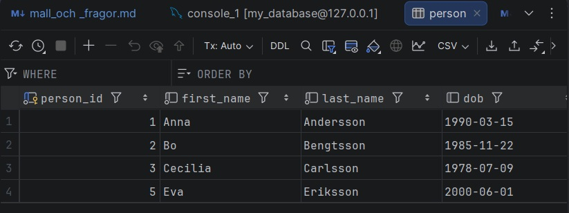
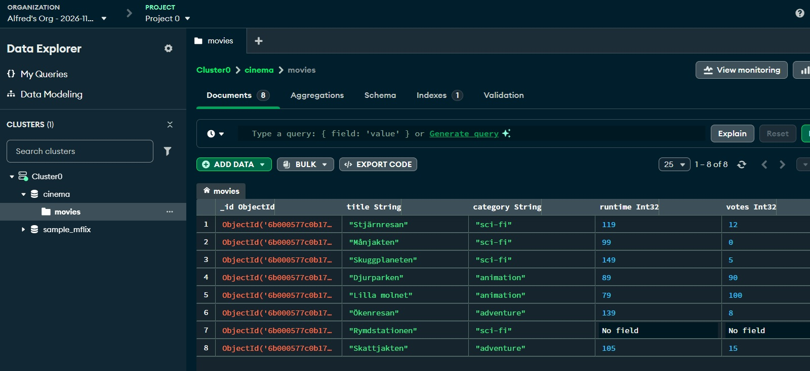
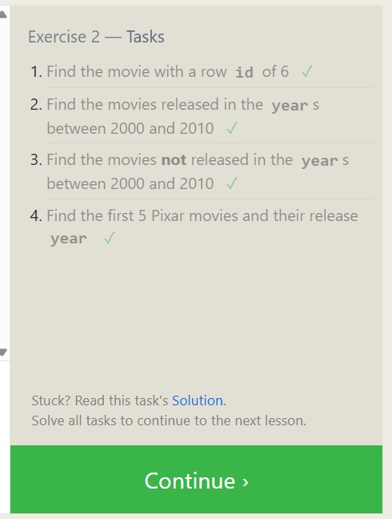

# Labb 1

## Alfred Löfving

# MySQL



# MongoDB



# SQL



### 1. Vad är en databas, och vad kan den användas till?

En databas är en samling data som kan finnas lokalt på datorn eller ligga på en server.
Den kan användas för att spara små till stora mängder information, såsom användaruppgifter på en hemsida,
bankkontoinformation, eller produkter i en webshop.
Datan är organiserad på olika sätt beroende på databasens typ.
En relationsdatabas lagrar datan i tabeller med rader och kolumner, medan en NoSQL-databas
kan använda andra modeller som exempelvis JSON.

### 2. Vad används språket SQL till?

SQL används för att skicka kommandon till en relationsdatabas. På så vis kan man hantera informationen
i databasen på olika sätt - hämta, lägga till, ändra, ta bort, eller filtrera på många olika sätt.

### 3. Vad är en tabell, en rad och en kolumn?

En tabell är en datastruktur som innehåller just rader och kolumner, där kolumner definierar vilka
fält varje rad innehåller och rader representerar ett eget objekt med alla dessa fält.
En rad kan t.ex innehålla en mobiltelefon, och kolumnerna dess tekniska specifikationer såsom
skärmstorlek, kamerans megapixlar, och vikt.

### 4. Vad är en primärnyckel, och varför behövs den?

En primärnyckel är en kolumn, ofta ett id, som används för att identifiera rader i en tabell.
Värdet är unikt och får inte vara tomt. Det kan användas som referens för att söka fram raden, eller
som referens i andra tabeller. Primärnyckeln behövs för att separera olika objekt från varandra när operationer
som UPDATE eller DELETE används, t.ex om två rader delar namnet "Anders Svensson".

### 5. Vad är en främmande nyckel?

En nyckel som refererar till en primärnyckel i en annan tabell och kopplar ihop två tabeller.
Om ett köp sparas i tabellen "purchase" kan exempelvis en kolumn med namnet "customer_id" vara en främmande nyckel
som refererar till ett id i tabellen "customer".

### 6. Varför är det bra att lagra kunduppgifter och köp i olika tabeller?

Det kan vara en dålig idé att blanda ihop två eller fler olika sorters rader överlag.
Kunduppgifter är t.ex information som bara kräver registrering en gång per person medan
köp kan genomföras flera gånger av samma person. Om man sparar dessa i samma tabell kan informationen se ut så här:

Hampus - hampus@hampus.se - iPhone 15 - 9 999 kr  
Hampus - hampus@hampus.se - Blackberry 12 - 7 999 kr

Detta innebär duplicerad data, och gör hanteringen av den krångligare ifall den behöver manipuleras. Om Hampus
byter emailadress behöver den ändras på fler ställen än ett. Därför vore det bättre att skriva
kunduppgifter till en tabell och köp till en annan.

### 7. Vad menas med NoSQL, och hur kan information organiseras i en sådan databas?

NoSQL (not only SQL) är ett samlingsnamn för databaser som inte använder sig av tabellmodellen.
Dessa databaser är mer flexibla och kan spara information i fler format, t.ex dokumentdatabaser
som använder sig av en JSON-liknande struktur. Det finns även nyckel-värde-databaser som fungerar ungefär
som en hashmap i Java, och grafdatabaser som Neo4j som kopplar samman noder.

### 8. Ge ett.exempel på när en NoSQL-databas kan vara lämplig och förklara varför.

NoSQL kan vara bättre när innehållet kan komma i många olika former med olika attribut. Dess flexibilitet
passar också för data som förändras ofta, t.ex chattar eller sociala medier.  
Exempel: En webshop med olika produkter, där produkterna har olika attribut.  
Skjorta - Storlek - Färg - Material  
Dator - Skärmstorlek - Färg - GB RAM

I en relationsdatabas hade många fält behövt vara tomma när attributen varierar. Med en NoSQL-databas behöver varje
produkt istället bara innehålla de attribut som är relevanta för just dem. NoSQL är dessutom ofta byggd för
att fördelas över flera servrar, vilket gör att det passar vid hög belastning.

### 9. Hämta alla kolumner för alla personer i tabellen.

```sql
SELECT *
FROM person;
```

### 10. Hämta endast förnamn och efternamn för alla personer.

```sql
SELECT first_name, last_name
FROM person;
```

### 11. Hämta förnamn, efternamn och inkomst för personer med en inkomst över 30 000.

```sql
SELECT first_name, last_name, income
FROM person
WHERE income > 30000;
```

### 12. Hämta alla personer födda före den 1 januari 1990.

```sql
SELECT *
FROM person
WHERE dob < '1990-01-01';
```

### 13. Hämta förnamn, efternamn och inkomst, sorterat efter inkomst från högst till lägst.

```sql
SELECT first_name, last_name, income
FROM person
ORDER BY income DESC;
```

### 14. Räkna hur många personer som finns i tabellen.

```sql
SELECT COUNT(*)
FROM person;
```

### VG 1: En banköverföring avbryts efter att pengarna dragits från det första kontot. Vad kan konsekvensen bli, och hur kan en transaktion hjälpa?

Om en banköverföring avbryts under processens förlopp (på grund av en krasch, nätverksfel, eller dylikt)
kan databasen hamna i ett inkonsekvent tillstånd där information har förlorats.
Det kan till exempel resultera i att uttaget från det första kontot finns men att insättningen saknas.
Konsekvensen av detta är att pengar som skulle hamna på det andra kontot har aldrig kommit fram trots att
de har dragits från det första, vilket vore katastrofalt i situationer där viktiga värden såsom saldon ändras.
Med hjälp av en transaktion förhindras detta tillstånd eftersom den grupperar ändringar och utför alla tillsammans.

En transaktion kan struktureras på följande sätt:

START TRANSACTION; <-- Ändringar efter detta hålls tillfälliga  
INSERT INTO, UPDATE, DELETE <-- Exempel på kommandon som ändrar informationen, t.ex uttag och insättning  
COMMIT; <-- Båda ändringarna verkställs samtidigt. Om något går fel används ROLLBACK istället

Transaktioner har fyra egenskaper, förkortade till ACID:

Atomicity: Antingen utförs alla ändringar eller ingen alls.  
Consistency: Databasen följer alltid sina egna regler, t.ex att en Foreign Key måste referera till en befintlig Primary
Key.  
Isolation: Registreringar är isolerade och påverkar inte varandra.  
Durability: När transaktionen är korrekt utförd med COMMIT finns ändringar kvar även efter
eventuell krasch, eftersom databasen vanligtvis sparar ändringarna i en logg på disk innan transaktionen bekräftats.

Med hjälp av kommandot ROLLBACK möjliggörs återställning av databasen till läget före transaktionen, med referens till
en “undo”-logg.

### VG 2: Välj ett enkelt system, antingen en webbutik eller en chatt. Resonera om när en relationsdatabas respektive en NoSQL-databas kan vara lämplig. Motivera med hur informationen ska lagras och användas.

Exempel: Webbutik
En relationsdatabas lämpar sig bäst när konsistens och transaktioner är viktiga. I en sådan kan data lagras i tabeller
och kopplas ihop med främmande nycklar och JOIN-kommandot. Varje uppgift sparas på ett ställe, vilket innebär att
information som ändras bara behöver göras en gång. Detta kallas normalisering. Med en relationsdatabas kan viktig
information som lagersaldo, ordrar, och betalningar hänga ihop, och bibehålla en struktur med tydliga relationer. En
produkt med endast 1 i lagersaldo måste bara kunna säljas en gång när en order läggs, så att en annan kund inte kan
betala för en produkt som inte finns. Även här är ACID-transaktioner viktiga.

För data med varierande struktur, som vitvaror där relevant information skiljer sig åt mellan exempelvis kylar med antal
hyllplan och spisar med glashäll eller induktion, passar NoSQL bättre. I en dokumentdatabas används JSON-liknande
dokument som kan innehålla all information om en specifik produkt, inklusive inbäddade arrayer eller objekt. På så vis
är webbutikens katalog mer flexibel då den kan innehålla mängder av olika produkter med sina egna, unika
informationsfält. Denna sorts information är oftast mindre beroende av strikt konsistens och transaktioner på samma
sätt som viktig kund- eller orderdata. Med NoSQL klarar databasen stora mängder data och snabb läsning, eftersom den är
mycket skalbar horisontellt över flera servrar.

Databassystem kombineras ofta på detta sätt, där relationsdatabasen innehåller ordrar och betalningar, och
NoSQL hanterar själva produktkatalogen.
