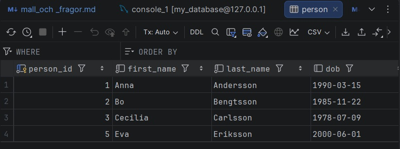
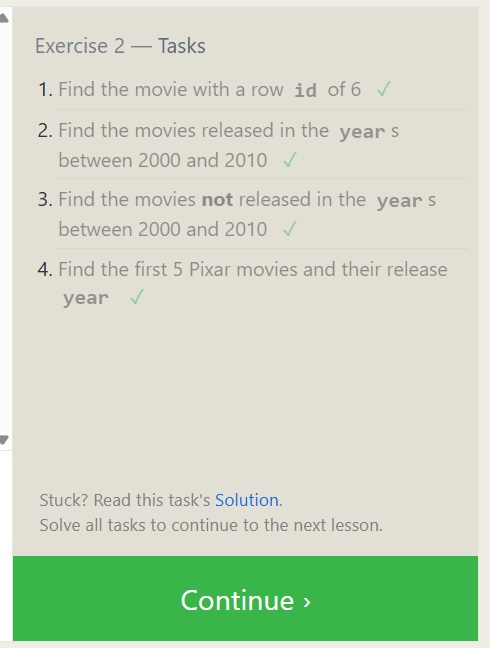

# Labb 1

# MySQL

Skärmdump som visar database explorer i IntelliJ med skapad person-tabell med data:

NOT: Ni ska även ha skapat en user som bara har access till databasen my_database, ingen bild krävs

# MongoDB

Skärmdump av databas på MongoDB Atlas med skapad movie-collection med data:

# SQL

Skärmdump som visar att ni klarat av första två sidorna på sqlbolt.com:s interaktiva tutorial

# Frågor som ni ska svara på (G-nivå)

Besvara frågorna med egna ord. Ge gärna exempel.

## Databaser och verktyg

1. Vad är en databas, och vad kan den användas till?
   En databas är en samling data som kan finnas lokalt på datorn eller ligga på en server.
   Datan är organiserad på olika sätt beroende på databasens typ.
   En relationsdatabas lagrar datan i tabeller med rader och kolumner, medans en NoSQL-databas
   kan använda andra modeller som exempelvis JSON.

2. Vad används språket SQL till?
   SQL används för att skicka kommandon till en relationsdatabas. På så vis kan man hantera informationen
   i databasen på olika sätt - hämta, lägga till, ändra, ta bort, eller filtrera på många olika sätt.

## Tabeller och relationer

3. Vad är en tabell, en rad och en kolumn?
   En tabell är en datastruktur som innehåller just rader och kolumner, där kolumner definierar vilka
   fält varje rad innehåller och rader representerar ett eget inlägg med alla dessa fält.
   En rad kan t ex innehålla en mobiltelefon, och kolumnerna dess tekniska specifikationer såsom
   skärmstorlek, kamerans megapixlar, och vikt.

4. Vad är en primärnyckel, och varför behövs den?
   En primärnyckel är ett värde som används för att identifiera rader i en tabell.
   Värdet är unikt för varje rad och kan användas som referens för att söka fram raden, eller
   som referens i andra tabeller.

5. Vad är en främmande nyckel?
   En nyckel som refererar till en primärnyckel i en annan tabell.

6. Varför är det bra att lagra kunduppgifter och köp i olika tabeller?
   Det är en dålig idé att blanda ihop två eller fler olika sorters rader överlag.
   Kunduppgifter är t ex information som bara kräver registrering en gång per person medans
   köp kan genomföras flera gånger av samma person. Om man sparar dessa i samma tabell kan infon se ut så här:

   Hampus - hampus@hampus.se - iPhone 15 - 9 999 kr
   Hampus - hampus@hampus.se - Blackberry 12 - 7 999 kr

   Detta innebär duplicerad data, och gör hanteringen av den krångligare ifall den behöver manipuleras.
   Därför vore det bättre att skriva kunduppgifter till en tabell och köp till en annan.

## NoSQL

7. Vad menas med NoSQL, och hur kan information organiseras i en sådan databas?
   NoSQL (not only sql) är ett samlingsnamn för databaser som inte använder sig av tabellmodellen.
   Dessa databaser är mer flexibla och kan spara information i fler format, t ex dokumentdatabaser
   som använder sig av en JSON-liknande struktur. Det finns även nyckel-värde-databaser, nyckel-kolumner,
   och grafdatabaser som använder nodes och edges.

8. Ge ett exempel på när en NoSQL-databas kan vara lämplig och förklara varför.
   NoSQL kan vara bättre för större datamängder eller hög belastning. Dess flexibilitet
   passar också för data som förändras ofta, t ex chattar eller sociala medier.
   Exempel: En webshop med olika produkter, där produkterna har olika attribut.
   Skjorta - Storlek - Färg - Material
   Dator - Skärmstorlek - Färg - GB ram

## SQL – hämta data från tabellen person

Skriv en SQL-fråga som svar på varje uppgift.

9. Hämta alla kolumner för alla personer i tabellen.

10. Hämta endast förnamn och efternamn för alla personer.

11. Hämta förnamn, efternamn och inkomst för personer med en inkomst över 30 000.

12. Hämta alla personer födda före den 1 januari 1990.

13. Hämta förnamn, efternamn och inkomst, sorterat efter inkomst från högst till lägst.

14. Räkna hur många personer som finns i tabellen.

# VG-nivå

Dessa frågor ska besvaras med ett längre svar, minst en halv A4-sida:

1. En banköverföring avbryts efter att pengarna dragits från det första kontot.
   Vad kan konsekvensen bli, och hur kan en transaktion hjälpa?

Om en banköverföring avbryts under processens förlopp (på grund av en krasch, nätverksfel, eller dylikt)
kan databasen hamna i ett inkonsekvent tillstånd där information har förlorats.
Det kan till exempel resultera i att uttaget från det första kontot finns men att insättningen saknas.
Konsekvensen av detta är att pengar som skulle hamna på det andra kontot har aldrig kommit fram trots att
de har dragits från det första, vilket vore katastrofalt i situationer där viktiga värden såsom saldon ändras.
Med hjälp av en transaktion förhindras detta tillstånd eftersom den grupperar ändringar och utför alla tillsammans.

En transaktion kan se ut på följande vis:
START TRANSACTION; <-- Ändringar efter detta hålls tillfälliga
INSERT INTO, UPDATE, DELETE <-- Kommandon som ändrar informationen, t ex uttag och insättning
COMMIT; <-- Båda ändringarna verkställs samtidigt

Transaktioner har fyra egenskaper, förkortade till ACID:
Atomicity: Antingen utförs alla ändringar eller ingen alls.
Consistency: Databasen följer alltid sina egna regler, t ex att en Foreign Key måste referera till en befintlig Primary
Key.
Isolation: Registreringar är isolerade och påverkar inte varandra.
Durability: När transaktionen är korrekt utförd med COMMIT finns ändringar kvar även efter
eventuell krasch, eftersom databasen vanligtvis sparar ändringarna i en logg på disk innan transaktionen bekräftats.

Med hjälp av kommandot ROLLBACK möjliggörs återställning av databasen till läget före transaktionen, med referens till
en “undo”-logg.

2. Välj ett enkelt system, antingen en webbutik eller en chatt.
   Resonera om när en relationsdatabas respektive en NoSQL-databas
   kan vara lämplig. Motivera med hur informationen ska lagras och användas.

